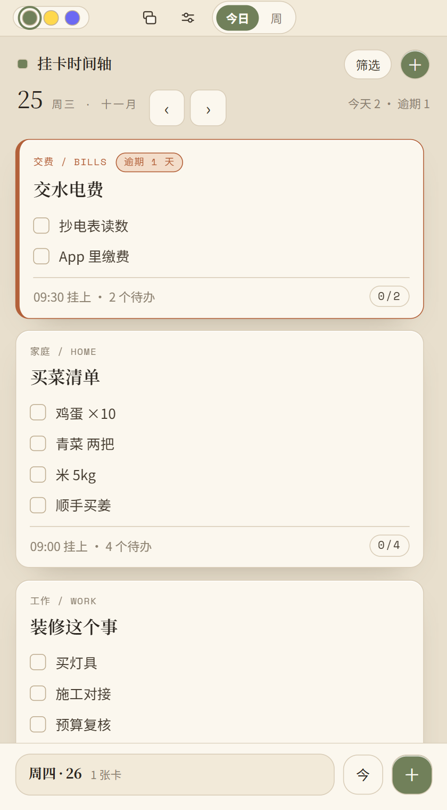
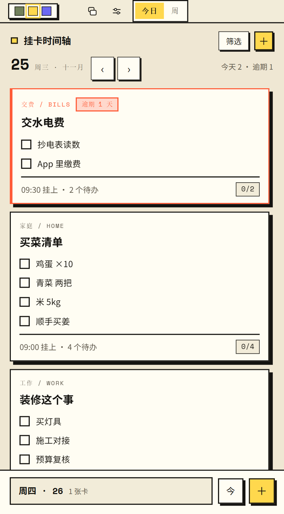
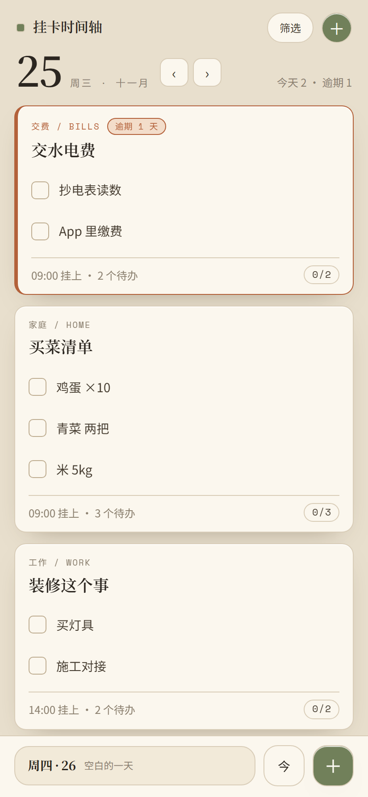
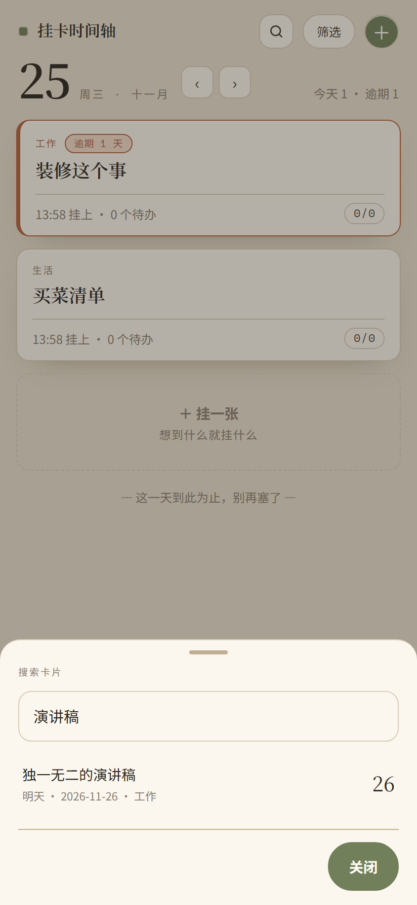
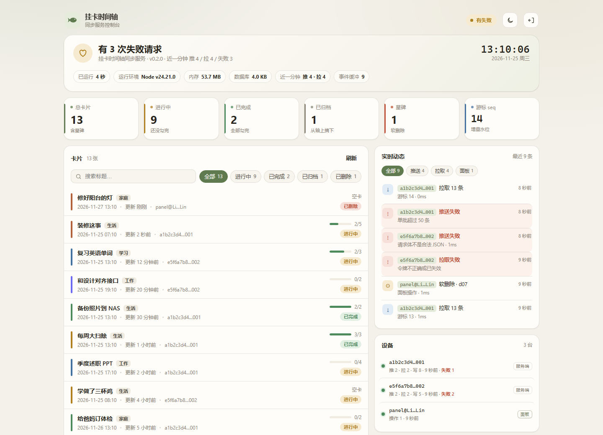
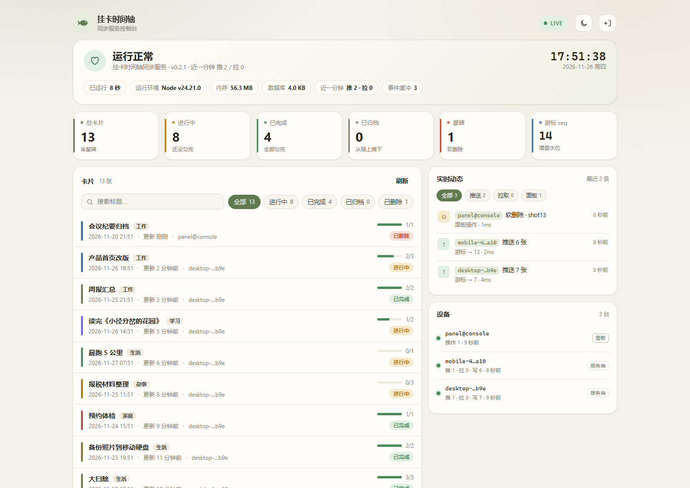

# 挂卡时间轴 · Timecard

> 把待办「挂」在时间轴节点上的个人任务应用 —— Windows 桌面端、Android 手机端，加一个自托管的同步服务器。
>
> 不是又一个滚动列表：卡片挂在「某一天」这条线上，一眼看清「今天要做什么、哪张卡逾期了」。



---

## 这是什么

传统的待办列表是「一长串往下滚」。挂卡时间轴换了个思路：**一张卡 = 挂在时间轴上的一件事**，每张卡里可以再拆若干「勾选项」。
时间轴负责回答「什么时候要做」，卡片负责回答「这件事还剩几步」。

- **三端同步**：桌面端（Electron）、手机端（Capacitor / Android）、服务器三端共用一套数据模型与同步协议
- **离线优先**：断网照常挂卡、打勾，联网后自动补推
- **自托管**：同步服务器是个单文件，自己一台小机器就能跑，数据完全归自己

---

## 界面预览

| 桌面 · 今日 | 桌面 · 周视图 |
|---|---|
|  |  |

| 手机端 | 全库搜索 |
|---|---|
|  |  |

| 服务器控制台 | 卡片详情 |
|---|---|
|  |  |

### 三套皮肤

同一份组件、三套视觉语言，桌面 / 手机 / 控制台都支持，切换即时生效：

- **自然有机（organic）**：米纸底、森林绿、衬线标题，像从便签本上撕下来的一张纸
- **野兽派（brutal）**：黑线、黄底、零圆角、硬投影，把卡片拍在桌上
- **新拟物质（neo）**：同色系双向阴影，凹是陷进去，凸是浮起来

---

## 功能一览

**桌面端（Windows）**
- 竖屏「今日」/ 横屏「周视图」按窗口宽度自动切换
- 全局快捷键 `Ctrl+Shift+Space` 呼出「挂一张」浮窗（置顶、无边框、Esc 收起）
- 键盘 `←/→` 逐天翻、`Home` 回今天；`Ctrl+F` 全库搜索（**标题 / 分类 / 条目内容**都能搜，命中条目会标出来）
- 卡片编辑（标题 / 分类 / 条目 / 改期 / **卡片主色**）、拖拽改期、全部打勾 / 取消
- 归档（从时间轴摘下但可搜到）、删除（软删除 + 撤销）
- **导出 / 导入 JSON 备份**（备份不含同步令牌；导入按 id 合并，可从备份恢复）
- 开机自启开关；标题栏同步状态点一下即可「立即同步」
- 本地落盘失败会在界面提示并可重试

**手机端（Android）**
- 单屏「今日」+ 逾期区，底部抽屉新建 / 编辑 / 设置
- 日期逐天翻、全库搜索（标题 / 分类 / 条目内容）、归档
- **下拉刷新同步**：列表在顶部往下拽松手即同步
- 硬件返回键：先关抽屉/筛选，再退出
- 同步失败自动退避重试、前台定期拉取

**同步服务器**
- Hono 一套代码，Node（`node:sqlite`）与 Cloudflare Workers（D1）双运行时
- 可打包成 **零依赖单文件** `server.mjs`，一条 `node` 命令即可跑
- 自带 **Web 控制台**：运行状态、实时同步动态、设备列表、卡片浏览、软删除 / 恢复、导出备份

---

## 仓库结构

```
timecard/
├─ packages/shared/   # 三端共用的数据模型 + 同步协议（唯一真源）
├─ apps/desktop/      # Windows 桌面端（Electron + React）
├─ apps/mobile/       # Android 手机端（Capacitor + React + Vite）
└─ apps/server/       # 同步服务器（Hono）+ Web 控制台
```

**技术栈**：TypeScript · React 19 · Electron · Capacitor 7 · Hono 4 · Vite · pnpm workspace

---

## 同步协议（简要）

**离线优先 + 操作日志 + 最后写入者胜（LWW）**，不是 CRDT。

1. 本地先写，再进 `Outbox`（断网也能改）
2. 推送时服务端按「`updatedAt` 先比、相同则 `deviceId` 字典序」决胜 —— 三端调用**同一个** `isNewer()`，保证算出一致结果，避免同步震荡
3. 拉取靠全局自增游标 `seq` 做**增量**，不整表同步
4. 卡片**永远软删除**（`deletedAt` 非空），物理删除会让它在别的设备上「复活」

细节见 [`packages/shared/src/sync.ts`](packages/shared/src/sync.ts)。

---

## 下载安装

不想自己编译的话，直接去 [Releases](https://github.com/fotlim/timecard/releases/latest) 下载现成包：

| 端 | 文件 | 说明 |
|---|---|---|
| Windows | `…-setup.exe` | 安装包未签名，首次运行会被 SmartScreen 拦一下：**更多信息 → 仍要运行** |
| Android | `Timecard-<版本>-android.apk` | 正式密钥签名（v1 + v2 + v3 全齐），支持 Android 6.0 及以上 |

**校验一下更稳**（能排除下载被截断这种「装不上」的常见原因）：

```bash
certutil -hashfile Timecard-0.1.3-android.apk SHA256   # Windows
sha256sum Timecard-0.1.3-android.apk                 # Linux / macOS
```

**小米 / 红米（MIUI · HyperOS）报「解析包错误 33 / packageInfo is null」**：这个错误是安装器读不到临时副本才抛的，多见于「浏览器下载面板直接点开」。换成 **文件管理 → 下载 → 点 APK** 安装；还不行就 `adb install -r Timecard-….apk`。

> ⚠️ 0.1.0–0.1.2 的 APK 用的是调试签名。换正式签名后**跨签名不能覆盖安装**，要先卸载旧版（本地数据会清空，确认已同步或不需要再卸）。

---

## 快速开始

> 需要 **Node ≥ 22.5** 和 **pnpm**。仓库是 pnpm workspace，先在根目录装依赖：

```bash
pnpm install
```

### 桌面端

```bash
pnpm --filter @timecard/desktop dev     # 开发模式
pnpm --filter @timecard/desktop dist    # 打 Windows 安装包（在 Windows 上）
```

### 手机端（Android）

需要 **JDK 21** 与 **Android SDK**：

```bash
pnpm --filter @timecard/mobile build
cd apps/mobile
npx cap sync android
cd android && ./gradlew assembleDebug     # 调试包：app/build/outputs/apk/debug/
cd android && ./gradlew assembleRelease   # 正式包（R8 压缩 + 资源裁剪）：app/build/outputs/apk/release/
```

**签名**：把 keystore 路径与口令写进 `apps/mobile/android/key.properties`（照抄 `key.properties.example`，该文件已 gitignore）；没有它时 release 会退化成 debug 签名，自己装得上，但别拿去发布。
包里的 `versionCode` / `versionName` 由 `apps/mobile/package.json` 的 `version` 自动推出来（`0.1.3 → 103`），不用手动改两个地方。

### 同步服务器

```bash
pnpm --filter @timecard/server build
TIMECARD_TOKEN=你的密钥 node apps/server/dist/node.js
# 浏览器打开 http://127.0.0.1:8787/ 是 Web 控制台
```

或者打成零依赖单文件：

```bash
node apps/server/scripts/bundle.mjs     # 产出 dist/server.mjs
TIMECARD_DB=./data/timecard.sqlite node dist/server.mjs
```

环境变量：`PORT`（默认 8787）、`HOST`（默认 127.0.0.1）、`TIMECARD_TOKEN`（访问令牌）、`TIMECARD_DB`（SQLite 路径）。

---

## 说明与边界

- 本项目是**个人自用**工具：单个令牌对应一个数据库，没有多用户 / 团队协作
- 令牌在客户端本地以明文存储，**不建议**存放高度敏感信息；请自行保管好服务器与令牌
- 冲突处理是**整卡覆盖**（LWW），不做条目级合并
- 服务器端没有内置速率限制，暴露到公网前请自行在反向代理层加访问控制

## 许可证

[MIT](LICENSE)
